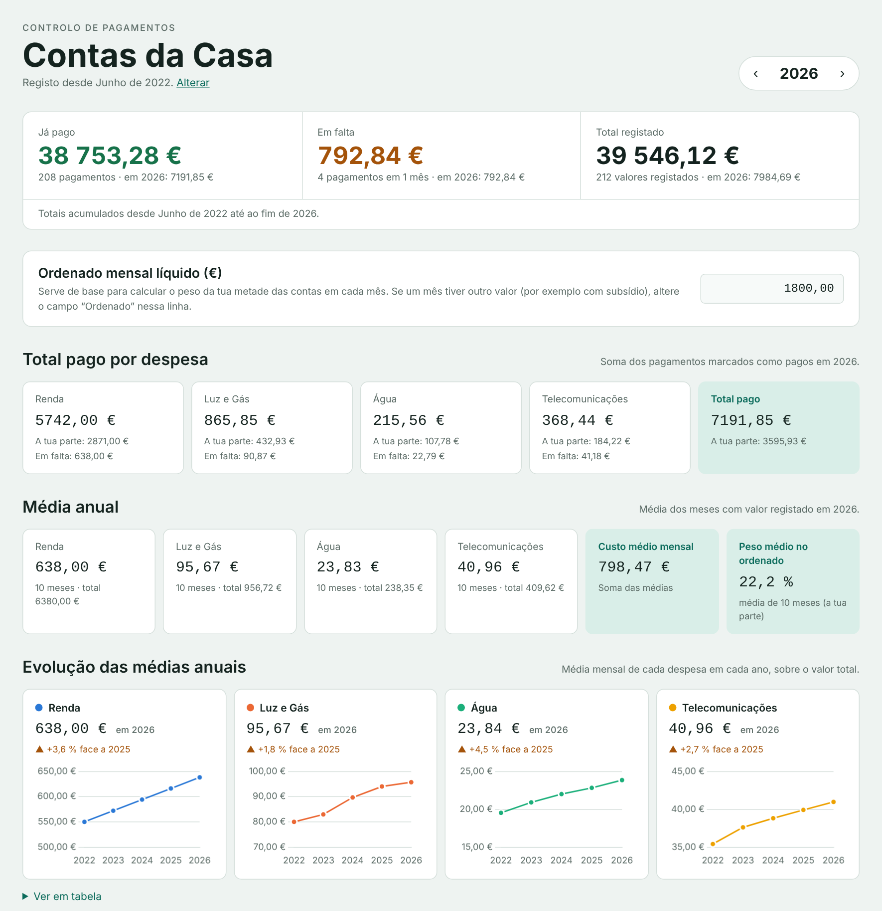
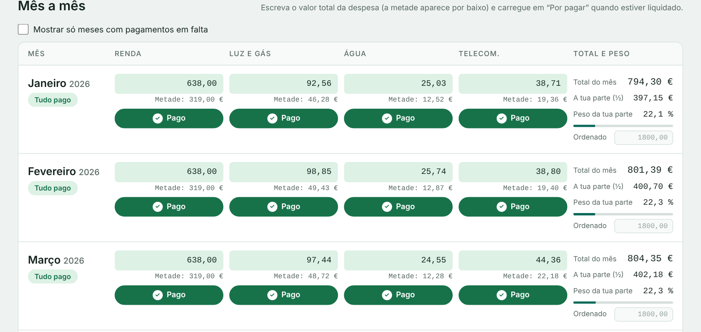
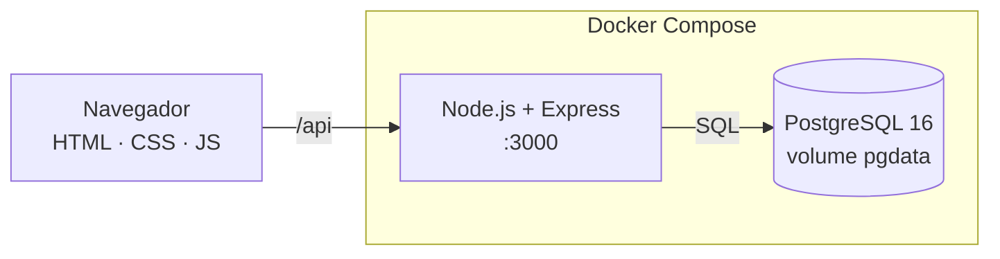

<div align="center">

# 🏠 Contas da Casa

**Controlo mensal das contas da casa, com histórico em PostgreSQL e arranque com um só comando.**


<picture>
  <source media="(prefers-color-scheme: dark)" srcset="docs/resumo-escuro.png">
  
</picture>

<sub>Capturas com dados de exemplo.</sub>

</div>

---

## Sobre

Aplicação web de uso pessoal para registar, mês a mês, o que se paga de **renda, luz e gás, água e telecomunicações** e saber o que já está pago e o que falta pagar. As despesas são divididas a dois, e a app mostra o peso da tua metade no ordenado, as médias anuais e a evolução de cada despesa ao longo dos anos.

Os valores são introduzidos à mão e guardados numa base de dados PostgreSQL, por isso o histórico não se perde ao fechar o navegador. Corre em `localhost`, sem contas nem serviços externos.

## Funcionalidades

- **Registo por mês e por despesa:** Janeiro 2026, Fevereiro 2026, …, com valor e estado "Por pagar / Pago" em cada despesa.
- **Divisão a dois:** por baixo de cada valor aparece a metade; o peso no ordenado é calculado sobre a tua parte.
- **Resumo acumulado:** "Já pago", "Em falta" e "Total registado" somam todos os anos desde o início do registo, com o valor do ano atual em destaque.
- **Total pago por despesa:** quanto já foi pago em renda, luz e gás, água e telecomunicações no ano escolhido.
- **Médias anuais:** média mensal de cada despesa (sobre o valor total) e peso médio no ordenado.
- **Evolução ao longo dos anos:** um gráfico por despesa, com a variação face ao ano anterior e uma tabela alternativa.
- **Ordenado flexível:** um ordenado base por ano, com ajuste em meses específicos (subsídios, por exemplo).
- **Início do registo configurável:** na primeira vez a app pergunta o mês e o ano em que começaste. Os meses anteriores não aparecem nem contam para os cálculos.
- **Filtro de meses em falta**, tema claro e escuro automático e layout adaptado a telemóvel.
- **Guarda automaticamente** pouco depois de cada alteração.

<div align="center">
  
</div>

## Como funciona



- O frontend é HTML, CSS e JavaScript simples, sem frameworks. O Chart.js é servido pela própria app, por isso os gráficos não dependem de CDNs.
- A API em Express lê e grava um **ano de cada vez**. A gravação substitui os dados desse ano numa única transação, por isso nunca fica um ano a meio.
- As migrações são feitas no arranque e podem correr várias vezes sem efeito. Por exemplo, a junção de "luz" e "gás" numa só despesa soma os valores antigos de cada mês.
- A aplicação e a base de dados só ficam acessíveis em `127.0.0.1`.

## Como correr

**Requisitos:** [Docker Desktop](https://www.docker.com/products/docker-desktop/) (ou Docker Engine com o plugin Compose).

```bash
git clone https://github.com/<o-teu-utilizador>/House_Bills.git
cd House_Bills
docker compose up -d --build
```

Abre **http://localhost:3000**. Na primeira vez a base de dados é criada sozinha e a app pergunta quando começaste a registar.

| Comando                        | O que faz                           |
| ------------------------------ | ----------------------------------- |
| `docker compose ps`            | mostra o estado dos serviços        |
| `docker compose logs -f app`   | mostra os registos da aplicação     |
| `docker compose stop`          | para tudo (os dados mantêm-se)      |
| `docker compose up -d`         | volta a arrancar                    |
| `docker compose up -d --build` | atualiza depois de alterar o código |

> ⚠️ `docker compose down -v` **apaga a base de dados**. Faz uma cópia de segurança antes (ver abaixo).

## Base de dados

| Tabela         | Conteúdo                                                                 |
| -------------- | ------------------------------------------------------------------------ |
| `payments`     | uma linha por ano, mês e despesa: `amount` (valor total) e `paid` (pago) |
| `settings`     | ordenado base de cada ano                                                |
| `month_salary` | ordenado de um mês concreto, quando difere do base                       |
| `app_config`   | ano e mês em que começou a registar (uma única linha)                    |

As categorias de `payments` são `renda`, `luzgas`, `agua` e `tel`.

**Ligar uma ferramenta externa** (DBeaver, pgAdmin, psql): servidor `localhost`, porta `5432`, base `contas`, utilizador `contas`, palavra-passe `contas_local`. Se a porta 5432 estiver ocupada, muda em `docker-compose.yml` a linha `127.0.0.1:5432:5432` para `127.0.0.1:5433:5432` e usa a porta 5433.

Consulta rápida na linha de comandos:

```bash
docker compose exec db psql -U contas contas -c "select * from payments order by year, month, category;"
```

### Cópia de segurança

```bash
# guardar
docker compose exec -T db pg_dump -U contas contas > backup-$(date +%F).sql

# repor (numa base de dados vazia)
docker compose exec -T db psql -U contas contas < backup-AAAA-MM-DD.sql
```

Guarda as cópias fora da pasta do projeto (disco externo ou cloud). Os dados vivem no volume Docker `pgdata`, que só existe neste computador.

### Importar histórico

Podes preencher os meses na própria página (muda de ano com as setas) ou importar um CSV com as colunas `year,month,category,amount,paid`:

```bash
docker compose cp historico.csv db:/tmp/historico.csv
docker compose exec db psql -U contas contas -c "\copy payments (year, month, category, amount, paid) from '/tmp/historico.csv' csv header"
```

## API

| Método | Rota                     | Descrição                                           |
| ------ | ------------------------ | --------------------------------------------------- |
| `GET`  | `/api/health`            | confirma que a base de dados responde               |
| `GET`  | `/api/config`            | início do registo (ano e mês)                       |
| `PUT`  | `/api/config`            | define o início do registo                          |
| `GET`  | `/api/year/:year`        | ordenado e pagamentos de um ano                     |
| `PUT`  | `/api/year/:year`        | grava um ano completo (transação)                   |
| `GET`  | `/api/totals?before=ANO` | totais pagos e em falta dos anos anteriores a `ANO` |
| `GET`  | `/api/averages`          | média mensal de cada despesa, por ano               |

## Estrutura do projeto

```
.
├── docker-compose.yml   # base de dados (PostgreSQL) + aplicação
├── Dockerfile           # imagem da aplicação (Node 22 Alpine)
├── server.js            # API Express, esquema e migrações
├── package.json
├── docs/                # capturas de ecrã usadas neste README
└── public/
    ├── index.html       # estrutura da página
    ├── styles.css       # estilos e temas claro/escuro
    ├── app.js           # lógica, cálculos e gráficos
    └── chart.umd.js     # Chart.js (servido localmente)
```

## Notas

- Projeto pensado para **uso pessoal numa só máquina**. A palavra-passe da base de dados está no `docker-compose.yml` e não há autenticação na aplicação, por isso não a exponhas na internet sem acrescentar proteção.


## Licença

- Ver o ficheiro [LICENSE](#license)
